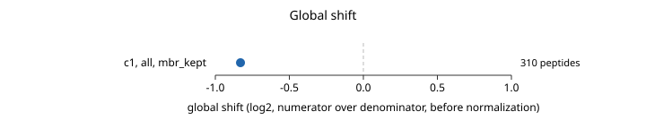

# Statistical report

Analysis `40e56c2e0cfeed5c` (`DEF-DIFF v1`). Generated from `DifferentialResults.metadata.json` and `DifferentialResults.tsv`; nothing here is written by hand.

## 1. Methods

**Software.** mzLib diff-1.0. Method version: diff-1.0.

**Inputs.** observation_table (in memory) (sha256 `2520820dbe636fdb...`); experimental_design `ExperimentalDesign.tsv` (sha256 `0b4bc363aa155786...`); peptide_quant `AllQuantifiedPeptides.tsv` (sha256 `5037da19478ca34c...`); protein_group_quant `AllQuantifiedProteinGroups.tsv` (sha256 `c226646557f66baf...`).

**Transformation and normalization.** All quantities were analysed on the log2 scale. Stratum `all`, basis `mbr_kept`: each sample was shifted by its median log2 difference from the across-sample reference, over the 310 peptides with a value in every sample that has values (at least 100 required). The per-sample shifts are in the metadata file.

**Missing values.** Missing values were not imputed: each model was fitted on the observed values only. A missing value is an empty cell in the results file, never 0.

**Models.**
- Stratum `all`, basis `mbr_kept`, `protein_group`, `moderated_t` (method `moderated`): `log2 y ~ condition`, fitted by REML; degrees of freedom by `moderated_residual`; an empirical-Bayes variance prior (`moments_legacy`) with 3.517 degrees of freedom and variance 0.392, fitted on 746 features.
- Stratum `all`, basis `mbr_kept`, `protein_group`, `peptide_mixed_model` (method `moderated`): `log2 y ~ peptide + condition + (1|sample)`, fitted by REML; degrees of freedom by `satterthwaite_moderated`; robust weighting: huber 1.345, MAD about 0, to convergence (100 rounds), else one round; an empirical-Bayes variance prior (`moments_legacy`) with 3.569 degrees of freedom and variance 0.254, fitted on 1,260 features.
- Stratum `all`, basis `mbr_kept`, `protein_group`, `peptide_mixed_model_reduced` (method `moderated`): `log2 y ~ peptide + condition + (1|sample), with only the random terms each protein's values can estimate (down to none)`, fitted by REML; degrees of freedom by `satterthwaite_moderated`; robust weighting: huber 1.345, MAD about 0, to convergence (100 rounds), else one round; an empirical-Bayes variance prior (`moments_legacy`) with 3.837 degrees of freedom and variance 0.246, fitted on 10 features.

Outlying values were down-weighted (robust weighting on).

**Tests.** Every comparison is tested two-sided. Each estimate is reported with its standard error, a 95% confidence interval (t-based, on the stated degrees of freedom), its test statistic, its degrees of freedom and an exact p-value.

**Multiple testing.** p-values were adjusted with the Benjamini–Hochberg method within each family of features sharing stratum, grain, quantity, quant basis, comparison and method: 1 family, their sizes in the metadata file.

**Thresholds.** No significance threshold was applied and no feature is labelled significant; the counts at adjusted p < 0.05 in section 3 are descriptive only (ASA statements, 2016 and 2019).

## 2. Design

### Stratum `all`

Factors: none (the whole dataset). Chosen by: default_list.

| level | samples | individuals |
|---|---|---|
| condition=control | 9 | not recorded |
| condition=progeria | 9 | not recorded |

- Batches: not recorded.
- Fractions: not recorded. Technical replicates: not recorded.
- No curated reference level: every pair of levels is compared.
- Samples without values: not recorded.
- Comparisons not run here: none.

### Comparisons

| id | comparison | numerator | denominator | covariate |
|---|---|---|---|---|
| c1 | condition=progeria vs condition=control | condition=progeria | condition=control |  |

### Design warnings

- No reference level was declared for factor 'condition', so every pair of its levels is compared (GR-14). Levels: control, progeria.

## 3. Results

| stratum | basis | grain | quantity | comparison | method | features | fitted | not fitted | adjusted p < 0.05 |
|---|---|---|---|---|---|---|---|---|---|
| all | mbr_kept | protein_group | abundance | c1 | moderated | 2,256 | 2,016 | 240 | 295 |

Not fitted, by reason:

| stratum | basis | comparison | method | status | features |
|---|---|---|---|---|---|
| all | mbr_kept | c1 | moderated | absent_in_denominator | 76 |
| all | mbr_kept | c1 | moderated | absent_in_numerator | 35 |
| all | mbr_kept | c1 | moderated | below_support:min_2_per_side | 110 |
| all | mbr_kept | c1 | moderated | below_support:no_unique_peptides | 19 |

Counts at adjusted p < 0.05 are descriptive only; no feature is labelled significant.

## 4. Diagnostics

### Figure 1. p-value histogram: stratum `all`, basis `mbr_kept`, `protein_group` `abundance`, comparison `c1`, method `moderated`

p-values of the 2,016 fitted features in 20 bins of width 0.05 (bin k holds 0.05k ≤ p < 0.05(k+1); p = 1 is in the last bin). With no change anywhere the bars are flat; a spike near 0 over a flat floor is expected when some features change; a U shape, or a slope rising toward 1, signals a problem with the model or the data. Data: [`figure_01_pvalue_histogram.tsv`](figures/figure_01_pvalue_histogram.tsv).

### Figure 2. Volcano: stratum `all`, basis `mbr_kept`, `protein_group` `abundance`, comparison `c1`, method `moderated`

log2 effect against -log10(p) for the 2,016 fitted features; no threshold lines are drawn. Data: [`figure_02_volcano.tsv`](figures/figure_02_volcano.tsv).

### Figure 3. Mean-variance: stratum `all`, basis `mbr_kept`, `protein_group`, `moderated_t`

Each feature's sqrt(sigma), the square root of its residual standard deviation, against its average log2 intensity, for 746 features, as limma's plotSA draws it. The line is the empirical-Bayes prior at the same scale ((s0^2)^(1/4)): flat, because the prior is constant. Data: [`figure_03_mean_variance.tsv`](figures/figure_03_mean_variance.tsv).

### Figure 4. Mean-variance: stratum `all`, basis `mbr_kept`, `protein_group`, `peptide_mixed_model`

Each feature's sqrt(sigma), the square root of its residual standard deviation, against its average log2 intensity, for 1,260 features, as limma's plotSA draws it. The line is the empirical-Bayes prior at the same scale ((s0^2)^(1/4)): flat, because the prior is constant. Data: [`figure_04_mean_variance.tsv`](figures/figure_04_mean_variance.tsv).

### Figure 5. Mean-variance: stratum `all`, basis `mbr_kept`, `protein_group`, `peptide_mixed_model_reduced`

Each feature's sqrt(sigma), the square root of its residual standard deviation, against its average log2 intensity, for 10 features, as limma's plotSA draws it. The line is the empirical-Bayes prior at the same scale ((s0^2)^(1/4)): flat, because the prior is constant. Data: [`figure_05_mean_variance.tsv`](figures/figure_05_mean_variance.tsv).

### Figure 6. Sample correlation: stratum `all`, basis `mbr_kept`

Pearson correlation of log2 values between each pair of the 18 samples, over the features both samples have; r needs at least 3 such features, and fewer leave the cell empty. The table gives r and the number of features. Data: [`figure_06_sample_correlation.tsv`](figures/figure_06_sample_correlation.tsv).

### Figure 7. Global shift per comparison, stratum and basis

Each comparison's global shift: the median, over peptides with a value in every sample on both sides, of the difference in mean log2 intensity, before normalization; 0 means the two sides sit level. The number of peptides each rests on is beside it. Data: [`figure_07_global_shift.tsv`](figures/figure_07_global_shift.tsv).

## 5. Reporting checklist

| item | asked for by | answered in | this run |
|---|---|---|---|
| Software and versions | JPR; PROTEOMICS; MIAPE-Quant 4.1 | 1. Methods | Y |
| Data transformation | JPR; PROTEOMICS; MIAPE-Quant 4.4 | 1. Methods | Y |
| Normalization | JPR; PROTEOMICS | 1. Methods | Y |
| Missing values | PROTEOMICS; MIAPE-Quant 4.4 | 1. Methods | Y |
| Statistical tests and sidedness | JPR; PROTEOMICS; Nature reporting summary | 1. Methods | Y |
| Degrees of freedom | PROTEOMICS; Nature reporting summary | 1. Methods; results file `df` | Y |
| Multiple-testing correction | Nature reporting summary; MIAPE-Quant 4.5 | 1. Methods | Y |
| Exact n per group | Nature reporting summary; MCP | 2. Design | Y |
| Biological and technical replicates | MCP; Nature reporting summary | 2. Design | N |
| Effect sizes with confidence intervals | Nature reporting summary; PROTEOMICS; JPR; MIAPE-Quant 4.5 | results file `log2_effect`, `ci_low`, `ci_high` | Y |
| Exact p-values | Nature reporting summary; ASA 2016 | results file `p_value` | Y |
| Thresholds and their justification | MIAPE-Quant 4.5; PROTEOMICS; ASA 2019 | 1. Methods | Y |
| Priors | Nature reporting summary | 1. Methods | Y |
| Level of each test in nested designs | Nature reporting summary | 1. Methods (model formulas) | Y |
| Power analysis | JPR (where appropriate) | not computed | N |

An N is a gap in this run, shown rather than left out.

## 6. Decisions applied

Every rule that changed what happened in this analysis, with how many protein groups (features) and result rows it touched. Each case is a line of `DifferentialDecisions.tsv`, which joins to the results on stratum, quant basis, feature and comparison.

| rule | ruling | what it does | lines | features | rows |
|---|---|---|---|---|---|
| `settings` | M5b-14 | the settings that applied to the whole analysis | 1 | 0 | 0 |
| `row_set` | M5b-12 | protein groups left out of the results: decoys, contaminants, entrapment groups, groups the protein table does not describe, and groups above 1% protein q | 1 | 0 | 0 |
| `no_unique_peptides` | M5b-6 | a protein group with no usable unique peptide (unique to the group and valued in at least 2 samples): no fit | 19 | 19 | 19 |
| `absent_side` | M5b-1 | a comparison one side of which has no value for the protein: reported absent, with no number | 111 | 111 | 111 |
| `min_per_side` | M5b-14 | a comparison with fewer samples with a value on a side than the settings ask: below support, no number | 110 | 110 | 110 |
| `reduced_design` | M5b-1 | a protein fitted on the design columns its own values can estimate (a group, batch or level it lacks left out) | 111 | 111 | 0 |
| `random_terms_dropped` | M5b-16 | random terms the protein's values cannot estimate left out of its model, down to least squares | 10 | 10 | 0 |
| `single_peptide` | M5b-6 | a protein with one usable peptide: tested with the moderated t-test | 746 | 746 | 0 |
| `robust_fell_back` | M5b-8 | robust reweighting that did not settle: the protein fitted on its first round's weights | 40 | 40 | 0 |

Settings: method moderated; robust weighting on (moderated_t rows are not reweighted); normalization shared_peptide_median, reference-set floor 100; at least 2 samples with a value per side; interval level 0.95; batch fitted; random terms: only those each protein's values can estimate.
